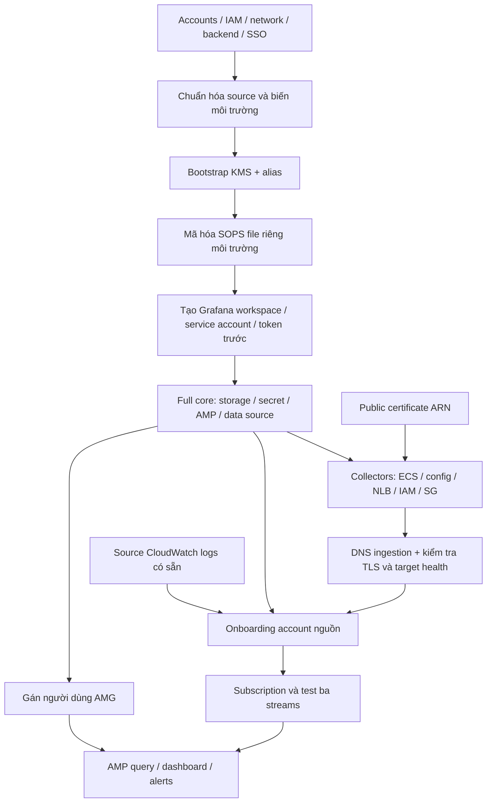

# Chromeleon — Flow hiện tại và hướng dẫn triển khai tài nguyên từ đầu

Ngày phân tích: 24/09/2026. Phân tích working tree hiện tại; chỉ Chromeleon và hạ tầng dùng chung cần cho flow. Không triển khai GitHub Collector. Đầu vào cần có sẵn được mô tả trong [codex-pre-resource.md](codex-pre-resource.md).

Tài liệu phân biệt **đã khai báo trong source**, **bước vận hành ngoài Terraform**, và **sửa đổi đề xuất trước rebuild**. Các sửa đổi nêu dưới đây chưa được thực hiện vào Terraform. Chưa truy cập AWS để kiểm kê, chạy plan/apply hoặc xác nhận E2E. “Từ đầu” ở đây là tạo môi trường/state mới có chủ đích, không phải xóa môi trường cũ.

## 1. Flow dữ liệu đang được triển khai

### 1.1 Từ logs tới metrics

| Bước | Thành phần và hành vi thực tế | Đầu vào → đầu ra | Chỗ khai báo |
|---|---|---|---|
| 1 | Chromeleon ghi log, log shipper chuyển lên CloudWatch | File/application logs → source log groups/streams | Ngoài repo; cần team Chromeleon triển khai |
| 2 | Subscription filter với pattern rỗng | Tất cả events trong group → Firehose | `onboarding/log-forwarding-template.yaml` |
| 3 | Firehose `DirectPut`, đích HTTP, buffer 1 MiB/60 giây, retry 300 giây | CloudWatch envelope → HTTP request Firehose, body GZIP, shared key | Template onboarding |
| 4 | Internet-facing NLB, listener TLS 443, target group TCP 8888 | HTTPS → TCP/HTTP tới Vector; TLS kết thúc ở NLB | Module Chromeleon |
| 5 | Vector source `aws_kinesis_firehose`, listen `0.0.0.0:8888` | Firehose records → events, kiểm tra `VECTOR_ACCESS_KEY` | `vector.yaml` |
| 6 | `parse_envelope` parse JSON `.message`, đổi tên `logStream`/`logGroup`; Lua `expand_events` | Một CloudWatch envelope → nhiều events chỉ giữ `message`, `log_stream` | `vector.yaml` |
| 7 | Route theo ba stream names chính xác, filter nội dung, regex và `log_to_metric` | Events hợp lệ → năm loại metric | `vector.yaml` |
| 8 | Prometheus remote-write sink gọi `http://localhost:8005/workspaces/<AMP_ID>/api/v1/remote_write` | Metrics → SigV4 proxy cùng task | Config render từ core state |
| 9 | Proxy ký request với service `aps`, region hiện tại và task role | Request có SigV4 → AMP | Container `sigv4-proxy` |
| 10 | AMG dùng IAM query role, data source Prometheus dùng SigV4 | PromQL → AMP → kết quả hiển thị | Core observability + `grafana_data_source.amp` |
| Nhánh lỗi | Firehose `FailedDataOnly` → S3 bucket TRONGPQ, prefix account nguồn | Lần giao HTTP thất bại → backup để điều tra/replay | Core bucket policy + onboarding S3 config |

Không có Prometheus scrape job, OTel collector hoặc GitHub exporter trong flow Chromeleon này. Không có Kinesis Data Streams, Lambda transform, Loki/OpenSearch hay database bổ sung. Những thành phần đó không cần tạo để tái lập flow hiện có.

CloudWatch envelope gồm `messageType`, `owner`, `logGroup`, `logStream`, `logEvents[]`. Có hai lớp nén khác nhau: record CloudWatch và HTTP body Firehose. Vector source có chức năng xử lý record compression; cần xác minh với **đúng image `0.41.1-debian`** trong source, không sao chép option từ tài liệu phiên bản mới một cách mặc định. [Vector Firehose source](https://vector.dev/docs/reference/configuration/sources/aws_kinesis_firehose/) giải thích sự khác nhau giữa hai lớp nén.

### 1.2 Metrics thực sự sinh ra

| Stream / điều kiện | Metric trong config | Labels | Lưu ý với sample đầu vào |
|---|---|---|---|
| `service-all`, chứa `Request finished HTTP` | `chromeleon_http_requests_total` | `method`, `endpoint`, `status_code` | Regex yêu cầu dạng HTTP/x.y, status, số bytes, content-type/token và duration `ms` |
| Cùng HTTP event | `chromeleon_http_duration_ms` (histogram) | `method`, `endpoint` | Đơn vị milliseconds, không phải seconds; kiểm tra các series `_bucket`, `_sum`, `_count` khi nghiệm thu |
| `sdk-commands`, chứa `Executing command:` | `chromeleon_sdk_commands_total` | `command` | Regex chỉ nhận command trong dấu nháy và `\w+` |
| `sdk-commands`, chứa `Creating SdkResponse with exit code` | `chromeleon_sdk_exits_total` | `exit_code`, `exit_reason` | Regex code chỉ `\d+`, không nhận số âm; reason chỉ `\w+` |
| `sdk-errors`, mở đầu ngày `YYYY-MM-DD`, khớp format thread/level/logger | `chromeleon_errors_total` | `level`, `logger` | Đếm dòng khớp, không lọc riêng level ERROR; continuation stack trace không được tính như lỗi độc lập |

Endpoint bỏ query string và host nhưng giữ ID trong path: `/orders/123` và `/orders/456` là hai label values. Cần chuẩn hóa route nếu dữ liệu thật có nhiều IDs để tránh tăng cardinality.

Lua không giữ `owner`, `log_group`, event ID và timestamp gốc. Do đó metrics hiện không phân biệt account/log group/host và không bảo toàn event time. Nhiều nguồn cùng labels có thể bị gộp; replay log cũ không tự tái tạo timeline cũ. Không có deduplication event IDs. Retry/replay có thể làm đếm trùng; không được coi counters này là sổ giao dịch chính xác một lần.

Các stream ngoài ba route không được nối tới sink. Các parser dùng hàm `!`; không có nhánh dead-letter/quarantine riêng và không khai báo rõ chính sách xử lý parse failure. Firehose HTTP success hoặc NLB TCP healthy không chứng minh log đã biến thành metric đúng trong AMP. Config cũng tắt sink healthcheck và không khai báo disk buffer/acknowledgement end-to-end; không suy ra bảo đảm không mất dữ liệu từ nhánh S3 backup.

### 1.3 Flow khởi động task và cập nhật

1. ECS execution role cho phép lấy secret và ghi runtime logs; image tải từ Docker Hub/Public ECR.
2. Container Vector chạy shell: `apt-get update` → cài AWS CLI → tải S3 config về `/tmp/vector.yaml` → khởi động Vector. Bất kỳ bước nào thất bại đều ngăn source listen port 8888.
3. S3 config dùng task role; AMP request cũng dùng task role thông qua proxy. Đây là hai role khác nhau với execution role, không chuyển quyền S3 sang execution role rồi bỏ task role.
4. Hai containers cùng task `awsvpc`, liên lạc qua `localhost`; proxy port 8005 không cần ingress public.
5. `aws_s3_object.vector_config` lưu config render, ECS service có `triggers.config_hash`. Đổi nội dung config sẽ kích hoạt deployment khi Terraform apply; sửa S3 object thủ công không đảm bảo restart task.
6. Đổi giá trị secret mà ARN/config giữ nguyên không tự tạo task revision/redeployment trong source. Cần restart deployment để task lấy secret mới.

## 2. Danh mục tài nguyên phải triển khai

Các địa chỉ trong bảng là địa chỉ Terraform thật. `data.*`, `locals`, variables, outputs và provider không phải resource AWS cần tạo. `tls_*` và `time_rotating` là resource do provider quản lý trong state, không phải dịch vụ AWS độc lập.

### 2.1 Core — account TRONGPQ, root `core/deployment`

| Resource/address (rút gọn theo module) | Đầu vào cần có | Vai trò / output cho bước sau |
|---|---|---|
| `module.storage.aws_kms_key.sops` + `aws_kms_alias.sops` | Account, IAM principals, `ci_role_arn`, `sops_kms_key_admin_arns` | KMS cho SOPS; output `sops_kms_key_arn`. Bootstrap trước full core |
| `module.storage.aws_s3_bucket.config` | `config_bucket_name` duy nhất | Bucket config; output `config_bucket_name` |
| Config bucket versioning, SSE config, public access block | Config bucket ID | Versioning bật, AES256, chặn public |
| `module.storage.aws_secretsmanager_secret.chromeleon_access_key` và secret version | Tên secret; decrypted SOPS `chromeleon_access_key` | Chuỗi key cho ECS; output `chromeleon_access_key_secret_arn` |
| `module.storage.aws_s3_bucket.firehose_backup` | `firehose_backup_bucket_name` | Bucket backup dùng chung; outputs name/ARN cho onboarding |
| Backup versioning, SSE config, public access block, ownership controls, bucket policy | Bucket; `firehose_backup_org_id` | AES256, `BucketOwnerPreferred`, cấp quyền theo Org/account prefix, deny xóa objects |
| `module.observability.aws_prometheus_workspace.this` | `amp_workspace_alias` | `amp_workspace_id`, ARN và endpoints |
| `module.observability.aws_iam_role.amg_query` + policy `amg_amp_query` | Role name, trust Grafana | Cho AMG query AMP; policy hiện scope `*` |
| `module.observability.aws_grafana_workspace.this` | `amg_workspace_name`, `grafana_version`, query role; Identity Center đã bật | AMG `CURRENT_ACCOUNT`, `AWS_SSO`, `CUSTOMER_MANAGED`; output endpoint |
| `aws_grafana_workspace_service_account.terraform` trong observability | Workspace ID | Service account ADMIN dùng automation, không phải quyền đăng nhập của user |
| `time_rotating.grafana_token_rotation` + `aws_grafana_workspace_service_account_token.terraform` trong observability | Service account, workspace | Rotate theo 25 ngày khi apply; TTL token 2.592.000 giây (30 ngày) |
| Root `grafana_data_source.amp` | AMG URL/token và AMP base endpoint | Tạo data source tên `Amazon Managed Prometheus`, POST, SigV4 region `eu-central-1` |

Secret TRONGPQ có `recovery_window_in_days=0`; destroy secret không có khoảng phục hồi cấu hình bởi source. Backup bucket có deny `DeleteObject`/`DeleteObjectVersion` cho mọi principal, chưa có lifecycle retention/replay job. Cần định nghĩa retention và quy trình dọn dữ liệu riêng, không chạy destroy để “reset từ đầu”.

### 2.2 Collectors — account TRONGPQ, root `collectors/deployment`

| Resource/address | Đầu vào cần có | Vai trò / cấu hình hiện tại |
|---|---|---|
| Root `aws_ecs_cluster.collectors` | `cluster_name` | Cluster dùng chung, vẫn cần giữ khi bỏ GitHub Collector |
| `module.chromeleon_collector.aws_cloudwatch_log_group.vector`, `.sigv4_proxy` | `service_name` | `/ecs/<service>/vector`, `/ecs/<service>/sigv4-proxy`, retention 30 ngày |
| `aws_iam_role.task_execution`, managed attachment, inline `task_execution_extra` | Secret ARN, ECS task trust | `AmazonECSTaskExecutionRolePolicy` + đọc đúng Chromeleon secret |
| `aws_iam_role.task`, inline `task` | Config bucket name, AMP ARN | Đọc S3 config; `aps:RemoteWrite`, GetSeries/GetLabels/GetMetricMetadata |
| `aws_security_group.nlb`, `.task` và bốn ingress/egress rules | `vpc_id` | Internet → NLB:443, NLB SG → task:8888; outbound IPv4 mở |
| `tls_private_key.nlb`, `tls_self_signed_cert.nlb`, `aws_acm_certificate.nlb` | Service name | Hiện tạo/import cert tự ký RSA 2048, 10 năm; **cần thay thiết kế TLS ở mục 3** |
| `aws_lb.this` | Service name, subnet IDs, NLB SG | NLB internet-facing; tag `cov:internet-facing=true` |
| `aws_lb_target_group.this` | VPC, service name | Target type IP, TCP 8888, TCP health check |
| `aws_lb_listener.tls` | NLB ARN, certificate ARN, target group ARN | TLS 443, policy `ELBSecurityPolicy-TLS13-1-2-2021-06` |
| `aws_s3_object.vector_config` | Core config bucket + rendered Vector YAML | Object `chromeleon/vector.yaml`, hash nội dung |
| `aws_ecs_task_definition.this` | Hai roles, secret ARN, images, config bucket, logs, region | Fargate/awsvpc; CPU 512, memory 1024 MiB; Vector + SigV4 proxy |
| `aws_ecs_service.this` | Cluster, task definition, subnets, task SG, target group | `desired_count=1`; public IP mặc định bật; depends_on config object/listener |

Rows không ghi prefix module ở trên đều thuộc `module.chromeleon_collector`. Vector image default `timberio/vector:0.41.1-debian`; proxy `public.ecr.aws/aws-observability/aws-sigv4-proxy:latest`. `vector_image_tag` chỉ nằm ở child module, root chưa expose biến này.

Core remote state chỉ cung cấp dữ liệu, không tạo thêm hạ tầng: collectors dùng `config_bucket_name`, `chromeleon_access_key_secret_arn`, `amp_workspace_arn`, `amp_workspace_id`. Path remote-write được ghép từ workspace ID. Output `amp_remote_write_url` tuy có comment dành cho nhánh khác không có nghĩa Chromeleon không dùng remote-write; nó tự ghép URL qua proxy.

### 2.3 Onboarding — account nguồn Chromeleon, ngoài Terraform

Triển khai [template CloudFormation](../onboarding/log-forwarding-template.yaml) sau khi TRONGPQ sẵn sàng. Không tạo tay cùng resource rồi lại deploy template trùng tên.

| Logical ID / resource | Tên/cấu hình | Đầu vào và phụ thuộc |
|---|---|---|
| `TrongpqIngestionSecret` / Secrets Manager | `trongpq-ingestion-access-key-<SourceSystemName>`; JSON `api_key` | `TrongpqAccessKey` trùng raw key bên TRONGPQ |
| `FirehoseRole` / IAM role + inline policy | `<SourceSystemName>-firehose-to-trongpq` | Trust Firehose + SourceAccount; đọc source secret, ghi backup account-prefix, ghi delivery logs |
| `FirehoseLogGroup` / CloudWatch Logs | `/aws/firehose/<SourceSystemName>-to-trongpq` | Template tạo group nhưng không đặt retention |
| Delivery log stream **cần bổ sung** | `HttpEndpointDelivery` | Template tham chiếu tên stream, chưa tạo `AWS::Logs::LogStream`; xem mục 3 |
| `FirehoseDeliveryStream` | `<SourceSystemName>-to-trongpq`, `DirectPut` | URL HTTPS, source secret, Firehose role, backup bucket TRONGPQ, log group/stream |
| `CwToFirehoseRole` / IAM role + policy | `<SourceSystemName>-cw-to-firehose` | Trust regional Logs service + source ARN account; PutRecord/PutRecordBatch đúng Firehose ARN |
| `SubscriptionFilter1` … `5` | Filter name `trongpq-forwarding`, pattern rỗng | Log group 1 bắt buộc, 2–5 tùy chọn; stream và CW role phải sẵn sàng |

`SourceSystemName` phải dài 2–31 ký tự, lowercase/digits/hyphens và bắt đầu bằng chữ theo template. Nếu QA/prod ở cùng source account, dùng tên phân biệt ví dụ `chromeleon-qa`, `chromeleon-prod`; nếu không sẽ trùng names.

Backup path là `<SOURCE_ACCOUNT_ID>/backup/errors/`; `backup/unused/` vẫn được khai báo làm S3 prefix. Không dùng account TRONGPQ làm prefix cho nguồn khác account. Bucket policy chỉ cấp theo **account**, không cách ly từng ứng dụng cùng account. Quyền cross-account cần cả identity policy phía nguồn và resource policy bucket; `ListBucketMultipartUploads` có phía role nguồn nhưng chưa có Allow tương ứng trong bucket policy hiện tại, cần kiểm tra/bổ sung nếu flow backup yêu cầu thao tác này.

### 2.4 Các thành phần ngoài source cần hoàn tất để người dùng sử dụng

| Thành phần | Khi nào / cách quản lý |
|---|---|
| DNS ingestion record và public ACM certificate | Certificate có trước listener; DNS trỏ NLB sau khi có NLB DNS; IaC bổ sung hoặc cloud team |
| Source log shipping, log groups và streams | Trước subscription/E2E; team Chromeleon |
| AMG user/group role assignment | Sau khi workspace được tạo; qua Console/CLI hoặc thêm `aws_grafana_role_association` |
| Dashboard Chromeleon | Sau khi metrics truy vấn được; repo chưa có dashboard resource/JSON cho flow này |
| Alerts và notification destination | Bổ sung nếu mục tiêu là monitoring có cảnh báo; source chưa tạo alert rules/contact points |
| Backup replay/retention và vận hành | Bổ sung quy trình; chưa có job replay, không tự phục hồi metrics từ S3 |

Grafana Explore đủ kiểm chứng metric; muốn bàn giao màn hình giám sát phải bổ sung dashboard. Không gọi deployment “đã có dashboard/alert” chỉ vì AMG được tạo.

## 3. Các điểm phải xử lý trước khi rebuild

### 3.1 Tách source chỉ có Chromeleon

Các comment hiện tại không vô hiệu hóa resource blocks. Trước full apply bản mới:

| File/phạm vi | Wiring cần bỏ khỏi bản Chromeleon-only |
|---|---|
| `collectors/deployment/main.tf` | Lời gọi `module.github_collector`; giữ cluster và module Chromeleon |
| Collectors `variables.tf`, tfvars và `outputs.tf` | Inputs/outputs chuyên dụng `github_service_name`, `github_repos` và output module GitHub |
| `core/deployment/main.tf` | Truyền GitHub secret name/value và việc đọc `data.sops_file.secrets.data["github_token"]` |
| Core/storage variables, main và outputs; core root variables/outputs | Secret/version/input/output chỉ phục vụ GitHub |
| SOPS file logical keys | Bản mới chỉ cần `chromeleon_access_key` sau khi gỡ toàn bộ tham chiếu token GitHub |

Không cần phân tích hoặc triển khai nội bộ module GitHub để làm các bước này. Nếu dùng state cũ, bỏ resource khỏi config có thể gây destroy; phải review kế hoạch riêng. Runbook dưới đây giả định state mới, không dùng `-target` như cách bỏ qua GitHub vĩnh viễn vì full apply/CI lần sau sẽ tạo lại nó.

### 3.2 Sửa TLS và DNS trước khi nối Firehose

Đề xuất cụ thể cho bản rebuild:

1. DNS/cloud team cấp public certificate cho `<ingestion-fqdn>` ở region của NLB và hoàn tất validation.
2. Thêm biến `ingestion_certificate_arn` vào collectors root và module Chromeleon, truyền từ tfvars.
3. Listener dùng ARN này; loại `tls_private_key.nlb`, `tls_self_signed_cert.nlb`, `aws_acm_certificate.nlb` khỏi **bản rebuild mới**. Có thể bỏ TLS provider nếu không còn resource dùng.
4. Tạo DNS CNAME/alias phù hợp từ FQDN đã cấp certificate tới DNS NLB sau apply.
5. `TrongpqIngestionUrl` là `https://<ingestion-fqdn>`, theo template không thêm port/path. Output NLB DNS là DNS target, không tự trở thành URL có certificate đúng.

Tên biến ở trên là **đề xuất mới**, chưa có trong source. Phương án khác là quản lý public ACM + DNS validation bằng Terraform, nhưng phải thêm resources và phụ thuộc validation; không đồng thời quản lý một certificate ở cả hai nơi.

### 3.3 Hoàn thiện log stream Firehose

AWS hướng dẫn tạo trước cả log group và log stream khi bật delivery logging qua API/CLI/CloudFormation. Template hiện chỉ tạo group, dù IAM role có `logs:CreateLogStream`; không nên mặc định dịch vụ sẽ tạo giúp stream. Thêm resource sau và để Firehose phụ thuộc nó. [AWS Firehose logging](https://docs.aws.amazon.com/firehose/latest/dev/monitoring-with-cloudwatch-logs.html).

```yaml
FirehoseDeliveryLogStream:
  Type: AWS::Logs::LogStream
  Properties:
    LogGroupName: !Ref FirehoseLogGroup
    LogStreamName: HttpEndpointDelivery
```

Trong `FirehoseDeliveryStream`, đổi dependency thành `DependsOn: FirehoseDeliveryLogStream` hoặc tham chiếu stream resource trong `CloudWatchLoggingOptions`. Chọn retention cho group thay vì bỏ trống dài hạn.

### 3.4 Các điểm cấu hình và vận hành còn thiếu

| Mức | Phát hiện | Việc cần làm / bằng chứng đạt |
|---|---|---|
| Trước init | State bucket/tên môi trường chưa tự tách theo key | QA/prod bucket riêng hoặc sửa key đồng bộ backend/remote-state |
| Trước full apply | Prod TODOs và thiếu encrypted file | Điền ARNs/network/state đúng; bootstrap key và tạo ciphertext riêng |
| Trước bootstrap cùng account | Alias KMS, secret name, AMG role name mặc định trùng | Parameter hóa KMS alias và expose AMG role name; secret root đã có input name; hoặc dùng account riêng |
| Trước data source | Grafana provider cần token nhưng token do cùng root tạo | Chạy targeted token apply trước full core như CI hiện có |
| Trước onboarding | Một task, NLB nhiều AZ, cross-zone chưa bật | Quyết định cross-zone/target coverage; test khi task reschedule sang AZ khác |
| Trước nghiệm thu | `sso_instance_arn` không được dùng, chưa có user association | Cấu hình Identity Center thực và gán user/group cho workspace |
| Trước E2E | Parser dựa vào exact stream/regex | Validate YAML render bằng đúng image, test samples thật cho ba streams |
| Trước production | Public registries + `apt-get` mỗi boot; proxy tag `latest` | Kiểm chứng egress và startup; nên build image có sẵn AWS CLI, pin images/digests để rebuild lặp lại được |
| Trước production | Không có dashboard/alerts, durable-buffer/replay strategy | Bổ sung theo yêu cầu monitoring và dữ liệu chấp nhận mất/trùng |
| CI | `approval_required` không dùng, auto-apply và schedule từ default branch | Chốt environment protection, nhánh/triggers; thêm concurrency theo environment/state nếu cần tránh các run xen kẽ |
| First boot | Service phụ thuộc role ARN nhưng chưa explicit policy attachments/secret version | Kiểm tra IAM propagation và rollout; khi sửa source cân nhắc dependency vào policy/secret sẵn sàng thay vì chỉ ARN |

Những cải tiến production không được coi là đã tồn tại. Nghiệm thu tối thiểu cần đường TLS/network hoạt động, task ổn định, Firehose backup đúng quyền và metrics thật truy vấn được.

## 4. Thứ tự triển khai và hợp đồng bàn giao



| Mốc | Thông tin/resource bàn giao cho bước tiếp |
|---|---|
| Sau bootstrap | KMS ARN, `.sops.yaml` đúng key, encrypted file đúng environment |
| Sau core | `config_bucket_name`, `chromeleon_access_key_secret_arn`, `amp_workspace_arn`, `amp_workspace_id`, backup bucket name/ARN, AMG endpoint |
| Sau collectors | Cluster/service name, NLB DNS; truy vấn thêm target group ARN và task health bằng AWS APIs |
| Sau DNS/TLS | URL `https://<ingestion-fqdn>` đã xác minh certificate |
| Gửi account nguồn | URL, shared key qua secret channel, backup bucket name, region, stream/format contract |
| Sau onboarding | CloudFormation stack ID, Firehose ARN, source secret ARN, source log groups/subscription IDs |
| Sau nghiệm thu | Bằng chứng 5 loại metrics, timestamp kiểm thử, quyền Grafana, backup test, danh sách hạn chế còn lại |

AMG workspace ID có ở output của module nhưng chưa expose ở root; lấy bằng AWS API khi gán người dùng hoặc thêm root output. NLB ARN cũng chỉ có child-module output. Không gọi `terraform output amg_workspace_id`/`nlb_arn` ở root rồi giả định chúng đang có.

## 5. Runbook triển khai local bằng PowerShell

Lệnh mẫu dành cho người triển khai, không phải các lệnh đã được chạy trong lần phân tích này. Thay tất cả placeholders. Chỉ chạy sau khi hoàn tất các sửa đổi cần thiết ở mục 3. Chọn một cơ chế điều khiển deployment tại một thời điểm, tránh local và CI apply cùng môi trường.

### 5.1 Chuẩn bị session và file inputs

```powershell
Set-Location C:\Users\Admin\Downloads\trongpq
$deployEnvironment = "trongpq-qa"
$deployStage = "<TARGET_STAGE>"
$deployRegion = "eu-central-1"
$deployStateBucket = "<STATE_BUCKET_CUA_ENV>"
$env:AWS_PROFILE = "<TRONGPQ_DEPLOY_PROFILE>"
$env:AWS_REGION = $deployRegion
$env:AWS_DEFAULT_REGION = $deployRegion
$env:TF_VAR_target_environment = $deployEnvironment
$env:TF_VAR_target_stage = $deployStage
aws sts get-caller-identity
terraform version
sops --version
```

Core tfvars cần: config/backup bucket names, AMP alias, AMG name/version, `ci_role_arn`, engineer ARNs, `firehose_backup_org_id`, secret name nếu tách môi trường cùng account. Collectors tfvars cần: VPC/subnets, `assign_public_ip`, core state bucket/key/region, cluster/service names và certificate ARN **sau khi thêm wiring đề xuất**. Không đưa shared key plaintext vào tfvars.

Provider constraints hiện có: core AWS `~> 6`, Grafana `~> 3`, SOPS `~> 1.0`, time `~> 0.9`; collectors AWS `~> 6`, TLS `~> 4`. Lockfiles hiện pin core AWS 6.51.0, Grafana 3.25.9, SOPS 1.4.1, time 0.14.0; collectors AWS 6.50.0, TLS 4.3.0. Giữ lockfile đã review để tái lập phiên bản, không tự chạy `init -upgrade` trong rebuild.

### 5.2 Init core backend và kiểm tra cấu hình

```powershell
terraform -chdir=core/deployment init `
  -backend-config="bucket=$deployStateBucket" `
  -backend-config="region=$deployRegion" `
  -backend-config="key=core/deployment/terraform.tfstate" `
  -backend-config="use_lockfile=true"
terraform -chdir=core/deployment fmt -check -recursive
terraform -chdir=core/deployment validate
terraform -chdir=core/deployment state list
```

Environment mới chưa có state là bình thường. Nếu thấy state có resources, dừng giả định “môi trường trắng” và xác định đó là state cần reuse/import hay bucket/key nhầm. Không chuyển backend bằng `-migrate-state` trừ khi đang làm migration có chủ đích.

### 5.3 Bootstrap KMS/SOPS trước full core

```powershell
terraform -chdir=core/deployment plan `
  -target=module.storage.aws_kms_key.sops `
  -target=module.storage.aws_kms_alias.sops `
  -var-file="./variables/$deployEnvironment.tfvars"

terraform -chdir=core/deployment apply `
  -target=module.storage.aws_kms_key.sops `
  -target=module.storage.aws_kms_alias.sops `
  -var-file="./variables/$deployEnvironment.tfvars"

terraform -chdir=core/deployment output -raw sops_kms_key_arn
```

Hai biến root bắt buộc `target_environment` và `target_stage` đã truyền qua `TF_VAR_*`. Đây là targeted bootstrap hẹp để tạo key trước khi SOPS data source cần decrypt. Kiểm tra plan chỉ gồm KMS/alias và dependencies; không target cả `module.storage` vì module đó gồm secret values cần SOPS.

Nếu output chưa có sau targeted apply, lấy ARN bằng `aws kms describe-key --key-id alias/trongpq-sops` với đúng account/region và alias đã parameter hóa nếu có. Không dùng state dump hoặc in secret để tìm key. Nếu SOPS vẫn bị evaluate trong bootstrap của cấu hình đã chỉnh, tách key/alias thành bootstrap root/state riêng rồi wire ARN rõ ràng hoặc import có kế hoạch; không tạo một key thủ công rồi để core tạo key khác.

Sửa `.sops.yaml` trỏ đúng key mới. Dùng SOPS editor tạo/sửa `core/deployment/secrets/<env>.enc.yaml`, chỉ logical field `chromeleon_access_key` sau khi bỏ GitHub wiring. Nếu file QA cũ thuộc key/account cũ, phải mã hóa mới với key mới; đổi ARN trong `.sops.yaml` không tự re-encrypt ciphertext cũ. Kiểm tra command exit code và người/CI thực sự decrypt được, không xuất plaintext vào console/log. Commit ciphertext, không commit plaintext hoặc key.

### 5.4 Tạo Grafana token trước, rồi full core

Pipeline đang làm bước token riêng vì Grafana provider cần auth đã biết trước khi quản lý data source. Local cũng làm tương tự:

```powershell
terraform -chdir=core/deployment apply `
  -target=module.observability.aws_grafana_workspace_service_account_token.terraform `
  -var-file="./variables/$deployEnvironment.tfvars"
```

Target kéo theo workspace, IAM role/service account và rotation dependencies cần thiết; **không thay thế full core apply**. Sau đó tạo plan ở thư mục tạm ngoài repo để không vô tình commit secret trong plan:

```powershell
$corePlanFile = Join-Path ([System.IO.Path]::GetTempPath()) "trongpq-$deployEnvironment-core.tfplan"
terraform -chdir=core/deployment plan `
  -var-file="./variables/$deployEnvironment.tfvars" `
  -out="$corePlanFile"
terraform -chdir=core/deployment apply "$corePlanFile"
```

Review giữa plan và apply: không có GitHub resources, không tạo network nền, không có destroy bất ngờ, bucket/key/account đúng. File plan chứa dữ liệu nhạy cảm, cần lưu/xóa theo quy trình bảo vệ của máy triển khai; `.gitignore` hiện chỉ có comment minh họa ignore tfplan, chưa có rule chủ động cho mọi plan.

Kiểm tra metadata/outputs riêng lẻ:

```powershell
terraform -chdir=core/deployment output config_bucket_name
terraform -chdir=core/deployment output amp_workspace_id
terraform -chdir=core/deployment output amp_workspace_arn
terraform -chdir=core/deployment output chromeleon_access_key_secret_arn
terraform -chdir=core/deployment output firehose_backup_bucket_name
terraform -chdir=core/deployment output amg_workspace_endpoint
```

AMP và AMG phải ACTIVE; secret phải có current version; config/backup buckets có policies như plan. Xác nhận Grafana data source được tạo. Root `amp_query_url` là endpoint query API; Grafana data source dùng **base AMP endpoint**, không thay nó bằng `/api/v1/query`.

### 5.5 Deploy collectors

Đảm bảo `core_state_bucket/key/region` trong tfvars trỏ đúng state vừa apply. `terraform_remote_state` không tự suy ra bucket từ GitHub variables.

```powershell
terraform -chdir=collectors/deployment init `
  -backend-config="bucket=$deployStateBucket" `
  -backend-config="region=$deployRegion" `
  -backend-config="key=collectors/deployment/terraform.tfstate" `
  -backend-config="use_lockfile=true"
terraform -chdir=collectors/deployment fmt -check -recursive
terraform -chdir=collectors/deployment validate

$collectorPlanFile = Join-Path ([System.IO.Path]::GetTempPath()) "trongpq-$deployEnvironment-collectors.tfplan"
terraform -chdir=collectors/deployment plan `
  -var-file="./variables/$deployEnvironment.tfvars" `
  -out="$collectorPlanFile"
terraform -chdir=collectors/deployment apply "$collectorPlanFile"
terraform -chdir=collectors/deployment output chromeleon_nlb_dns_name
```

Review plan đúng resource inventory mục 2.2, certificate đã sửa, config rendered giữ `${VECTOR_ACCESS_KEY}` cho Vector runtime thay vì plaintext key. Trong template nguồn là `$${VECTOR_ACCESS_KEY}` để thoát Terraform interpolation; đường AMP phải render đúng workspace ID.

Terraform apply xong chưa chứng minh ECS service ổn định. Kiểm tra:

```powershell
$chromeleonCluster = "trongpq-collectors-qa"
$chromeleonService = "chromeleon-collector-qa"
aws ecs wait services-stable --cluster $chromeleonCluster --services $chromeleonService
aws ecs describe-services --cluster $chromeleonCluster --services $chromeleonService `
  --query 'services[].{Status:status,Desired:desiredCount,Running:runningCount,Events:events[0:5]}'
aws logs tail "/ecs/$chromeleonService/vector" --since 15m
aws logs tail "/ecs/$chromeleonService/sigv4-proxy" --since 15m
```

Thay cluster/service theo environment. Hai containers phải running, không loop restart; Vector tải được config và listen 8888, proxy không báo lỗi credentials/signature. Kiểm tra target health qua `aws elbv2 describe-target-health --target-group-arn <ARN>`; TCP healthy chỉ là điều kiện network, chưa là bằng chứng remote-write thành công.

Tạo DNS record theo thiết kế TLS. `Resolve-DnsName <ingestion-fqdn>` và `curl.exe -v https://<ingestion-fqdn>/` không dùng `-k` để kiểm tra TLS. GET có thể bị từ chối vì endpoint cần Firehose POST/auth; đó không phải bài test ingestion đầy đủ. Cần bài E2E bên dưới.

### 5.6 Gán quyền AMG và cấu hình người dùng

Lấy workspace ID bằng AWS Grafana API/Console, gán user/group Identity Center vào workspace với role phù hợp. Service account ADMIN của Terraform không tự cấp quyền cho người dùng SSO. Đăng nhập bằng người dùng thật, mở data source và kiểm tra query; sau E2E tạo/import dashboard cho năm loại metrics.

### 5.7 Onboarding account nguồn bằng CloudFormation

Chuẩn bị parameter values:

| Parameter | Giá trị |
|---|---|
| `SourceSystemName` | `chromeleon-qa` hoặc tên duy nhất đã thống nhất |
| `TrongpqIngestionUrl` | `https://<ingestion-fqdn>` đã xác minh TLS |
| `TrongpqAccessKey` | Cùng raw key trong TRONGPQ secret; template đặt `NoEcho` |
| `TrongpqBackupBucketName` | Output core `firehose_backup_bucket_name` |
| `LogGroupName1` | Source group thật đã có logs; bắt buộc |
| `LogGroupName2` … `5` | Nhóm bổ sung hoặc chuỗi rỗng |

Chuyển profile sang account nguồn và xác nhận lại danh tính. Có thể upload template đã sửa ở mục 3.3 vào CloudFormation Console, nhập parameters và chọn capability tạo named IAM resources (`CAPABILITY_NAMED_IAM`). Hoặc dùng CI/CLI bảo mật riêng với parameter file ngoài Git. Không chép raw key vào command history hoặc tài liệu; `NoEcho` không che được một key đã được ghi ở command line/log phía client.

Tạo stack, review resources và đợi `CREATE_COMPLETE`/`UPDATE_COMPLETE`. Template không tạo backup bucket và source log groups. Kiểm tra subscription đúng group, Firehose ACTIVE, log stream `HttpEndpointDelivery` đã có. Không gắn source production vào URL QA do nhầm shared key/endpoint.

Các prefix backup phải bắt đầu bằng source account ID. Source role có quyền `PutObject`, `PutObjectAcl`, multipart/read/list thích hợp; bucket policy khớp Org và ACL `bucket-owner-full-control`. Không kết luận backup tốt chỉ vì HTTP delivery tốt.

## 6. Nghiệm thu E2E và phân tích lỗi theo chặng

### 6.1 Gửi sample qua CloudWatch nguồn

Dùng log group kiểm thử đã được subscribe vào cùng Firehose và có ba log streams tương ứng. Đoạn dưới ghi events vào AWS khi người triển khai chạy; không thực thi nếu chưa chọn đúng group/profile.

```powershell
$sourceLogGroup = "<SOURCE_TEST_LOG_GROUP>"
$sourceAwsRegion = "eu-central-1"
$sampleCases = @(
  @{ Stream = "service-all"; Message = 'Request finished HTTP/1.1 GET https://chromeleon.local/api/codex-e2e - 200 512 bytes 42.5ms' },
  @{ Stream = "sdk-commands"; Message = 'Executing command: "Status"' },
  @{ Stream = "sdk-commands"; Message = 'Creating SdkResponse with exit code 0 (Success)' },
  @{ Stream = "sdk-errors"; Message = '2026-09-24 12:00:00 [1] ERROR CodexE2E - Synthetic test error' }
)
foreach ($sampleCase in $sampleCases) {
  $samplePayload = @{
    logGroupName = $sourceLogGroup
    logStreamName = $sampleCase.Stream
    logEvents = @(@{
      timestamp = [DateTimeOffset]::UtcNow.ToUnixTimeMilliseconds()
      message = $sampleCase.Message
    })
  } | ConvertTo-Json -Depth 5
  $sampleFile = Join-Path ([System.IO.Path]::GetTempPath()) "trongpq-chromeleon-e2e.json"
  [System.IO.File]::WriteAllText($sampleFile, $samplePayload, [System.Text.UTF8Encoding]::new($false))
  aws logs put-log-events --cli-input-json "file://$sampleFile" --region $sourceAwsRegion
  if ($LASTEXITCODE -ne 0) { throw "Không gửi được E2E event" }
}
```

Chờ ít nhất một vài chu kỳ buffering, theo dõi tiến độ thay vì coi 60 giây là SLA tuyệt đối. Trong Grafana Explore truy vấn:

```promql
chromeleon_http_requests_total{endpoint="/api/codex-e2e",method="GET",status_code="200"}
chromeleon_http_duration_ms_count{endpoint="/api/codex-e2e",method="GET"}
chromeleon_sdk_commands_total{command="Status"}
chromeleon_sdk_exits_total{exit_code="0",exit_reason="Success"}
chromeleon_errors_total{logger="CodexE2E",level="ERROR"}
```

Mỗi dòng là một query riêng. Kiểm tra histogram sum/count phù hợp sample 42.5 ms và labels đúng. Nếu không thấy series histogram dự kiến, xem series thực được Vector `0.41.1` xuất ra trước khi kết luận ingest hỏng. Test thêm log samples thật; synthetic sample chỉ chứng minh parser với đúng dạng này.

### 6.2 Điều kiện nghiệm thu theo resource

| Chặng | Bằng chứng cần có | Nếu lỗi, kiểm tra |
|---|---|---|
| Application → CloudWatch | Dòng mới xuất hiện trong đúng group/stream | Agent/config/file permissions/IAM nguồn |
| Subscription → Firehose | Subscription ARN đúng; số records vào tăng | Filter, source role/trust, region, log group đã subscribe |
| Firehose → NLB | Delivery metrics thành công, không có TLS/auth failures | DNS/cert chain/hostname/443/endpoint URL; shared key format |
| NLB → task | Target healthy, cả hai containers ổn định | SG 8888, NACL/routing, AZ coverage, startup `apt-get`/S3 |
| Vector parse | Năm loại metric khớp samples | GZIP/envelope, stream names, regex, remap/Lua errors |
| Proxy → AMP | Samples query được bằng PromQL | Task role AMP ARN, region/signature, localhost port, workspace path |
| AMG → AMP | Người dùng SSO thật query được data source | Role association, data source auth/region, AMG query role |
| Firehose → backup S3 | Bài failed-delivery có kiểm soát ở QA ghi được đúng prefix | Org ID, bucket ownership/ACL, role + bucket policy, multipart permissions |

Firehose metrics nên xem `DeliveryToHttpEndpoint.Success`, `DeliveryToHttpEndpoint.DataFreshness` cùng delivery error logs. Firehose ACTIVE và CloudFormation COMPLETE chỉ xác nhận control plane, không chứng minh metrics đã tới AMP. HTTP response còn phải khớp Firehose contract, gồm requestId/timestamp; HTTP 200 rỗng cũng không đủ. [AWS delivery contract](https://docs.aws.amazon.com/firehose/latest/dev/httpdeliveryrequestresponse.html).

Bài backup nên dùng stream/stack kiểm thử hoặc khoảng thời gian QA được kiểm soát, cố ý gây delivery failure rồi xác nhận objects trong `<source-account>/backup/errors/` và khôi phục endpoint/key. Không thay key đang phục vụ production để thử lỗi. Không có automatic replay trong source; backup tồn tại không đồng nghĩa metric đã phục hồi.

## 7. Triển khai bằng CI sau bootstrap

Workflow hiện tại tự chạy theo thứ tự:

```text
core-qa → collector-qa → core-prod → collector-prod
```

Core job luôn targeted apply Grafana token trước full apply. CI **chưa bootstrap KMS/SOPS**, nên phải làm mục 5.3 cho mỗi environment trước lần chạy full pipeline. Onboarding CloudFormation, public DNS/certificate theo đề xuất và user assignment không nằm trong workflow này.

Schedule ngày một lần hỗ trợ token rotation 25 ngày/TTL 30 ngày, nhưng `time_rotating` không tự chạy ở AWS khi workflow ngừng. Nếu token hết hạn, xác minh bước targeted token replacement hoàn tất trước full apply; có thể cần chủ động replace token trong một plan được review nếu cơ chế rotation chưa giải quyết được. Không xuất token vào logs.

Trước bật prod: hoàn tất QA E2E, tách backend/names, điền prod ARNs/network, tạo prod ciphertext, cấp TLS và source stack riêng. Main/default-branch schedule có thể chạy cả prod theo điều kiện trong workflow; cấu hình bảo vệ environment phù hợp. Thay đổi docs/onboarding riêng không tự triển khai hạ tầng.

## 8. Vận hành sau deployment

- **Đổi Vector config:** validate bằng đúng image và sample, apply collectors, chờ ECS rollout và query lại các metrics bị tác động. Không chỉ sửa object S3.
- **Rotate shared key:** cập nhật SOPS → apply core → phối hợp cập nhật source secret JSON và force ECS deployment để lấy raw key mới. Hiện Vector chỉ cấu hình một key, nên cần cửa sổ chuyển đổi/retry có kiểm soát hoặc thiết kế hỗ trợ hai key trước; không hứa zero downtime.
- **Đổi region/account:** cập nhật backend, remote state, IAM ARNs, network, Org policy, SOPS key/ciphertext, TLS và SigV4 region hardcode của data source.
- **Rebuild bằng state mới:** dùng resource names mới hoặc import có chủ đích nếu tái sử dụng resource; không để hai states cùng quản lý một resource.
- **Scale task:** đánh giá label/writer identity và counter aggregation trước khi tăng replicas; nhiều writers cùng Prometheus series không tự tạo mô hình HA metrics đúng.
- **Độ bền dữ liệu:** ghi rõ giới hạn một task, không dedup, không event-time preservation, không durable buffer/replay được khai báo. Bổ sung labels account/environment và dead-letter cho parse errors nếu cần vận hành nhiều nguồn.

## 9. Checklist hoàn tất

- [ ] Nền tảng trong `codex-pre-resource.md` đã được xác minh từng environment.
- [ ] Bản source deploy chỉ còn Chromeleon và tài nguyên shared cần thiết; không vô tình apply GitHub Collector.
- [ ] KMS/SOPS bootstrap xong; key/ciphertext/account đúng và CI decrypt được.
- [ ] Core state có đủ outputs; Grafana token/data source hoạt động.
- [ ] Collectors dùng đúng core state; Vector/proxy ổn định và NLB target health đạt.
- [ ] URL ingestion có DNS/certificate đúng; không dựa vào certificate tự ký `.internal` để nghiệm thu.
- [ ] Source logs, CloudFormation forwarding, delivery log stream và subscriptions đầy đủ.
- [ ] Cả năm loại metric query được từ sample kiểm thử và samples thực tế.
- [ ] Backup cross-account được kiểm chứng độc lập với HTTP delivery.
- [ ] Người dùng thật đăng nhập AMG được; dashboard/alerts cần thiết đã được bổ sung hoặc ghi rõ chưa nằm trong deliverable hạ tầng.
- [ ] Có owner cho key/token rotation, image/config updates, retention, replay và theo dõi ingest errors.

## 10. Hướng dẫn viết Terraform từ số 0 theo thứ tự phụ thuộc

Phần này hướng dẫn **thứ tự viết code**, bổ sung cho thứ tự chạy triển khai ở mục 5. Terraform không chạy từ trên xuống dưới file `.tf`: nó tạo dependency graph từ các tham chiếu resource/module. Đặt tên `01-...tf`, `02-...tf` chỉ giúp người đọc; `depends_on` và tham chiếu giá trị mới quyết định dependency.

Các đoạn HCL dưới đây là mẫu cho **bản rebuild Chromeleon-only**, không phải các thay đổi đã được áp dụng vào source. Không dán thêm block trùng tên vào file hiện có. Với resource đã có, sửa/thay block tương ứng. Các đoạn mẫu được chia theo từng file; kết hợp theo hướng dẫn và bổ sung các policy/config được chỉ rõ trước khi validate/plan.

### 10.1 Thứ tự viết tổng thể

| Bước viết | File/module cần viết | Resource/chức năng | Dependency phải nối |
|---|---|---|---|
| 1 | Hai root `terraform.tf`, `variables.tf`, tfvars | Providers, backend, biến môi trường/network/state | Nhận nền tảng đã có sẵn |
| 2 | Core `modules/storage`: KMS và outputs | KMS key + alias SOPS | IAM principals có sẵn |
| 3 | Core `modules/storage`: buckets/secrets | Config bucket, backup bucket/policy, secret/version | SOPS ciphertext sau bootstrap KMS |
| 4 | Core `modules/observability` | AMP → query role → AMG → service account/token | Identity Center có sẵn |
| 5 | Core root `main.tf`, `outputs.tf` | Wire modules, SOPS, Grafana data source, outputs | Module outputs cấp provider/data source và collectors |
| 6 | Collectors root `main.tf` | Remote state core, ECS cluster | Core full apply xong khi chạy plan thực |
| 7 | Module Chromeleon: logs/IAM/config | Log groups, execution role, task role, S3 config object | Secret ARN, config bucket, AMP ARN/ID |
| 8 | Module Chromeleon: network | SG → NLB/target group → TLS listener | VPC/subnets và public certificate có sẵn |
| 9 | Module Chromeleon: compute | Task definition → ECS service | Roles/policies, logs, config, listener, secret có version |
| 10 | Collectors root wiring/outputs | Gọi module, render Vector config, xuất NLB DNS | Root inputs và core outputs |
| 11 | Ngoài hai root Terraform | DNS record, source forwarding stack, AMG assignments | Collector/core đã sẵn sàng |

Viết xong một module thì hoàn thiện `variables.tf` và `outputs.tf` của module đó trước khi nối sang root. Bạn có thể viết toàn bộ code trước khi cấp hạ tầng; lúc chạy thật vẫn phải bootstrap KMS, mã hóa SOPS, tạo token rồi mới full apply theo mục 5.

### 10.2 Bước 1 — Tạo khung thư mục và hợp đồng biến

Giữ cấu trúc hiện tại để tận dụng CI và hai state keys:

```text
core/deployment/
  terraform.tf
  variables.tf
  main.tf
  outputs.tf
  variables/trongpq-qa.tfvars
  variables/trongpq-prod.tfvars
  secrets/<environment>.enc.yaml
  modules/storage/{main,variables,outputs}.tf
  modules/observability/{main,variables,outputs}.tf
collectors/deployment/
  terraform.tf
  variables.tf
  main.tf
  outputs.tf
  variables/trongpq-qa.tfvars
  variables/trongpq-prod.tfvars
  modules/chromeleon-collector/{main,variables,outputs}.tf
collectors/config/chromeleon/vector.yaml
```

Ở cả hai root, khai báo backend `s3` rỗng như source hiện có và AWS provider. Core giữ thêm Grafana/SOPS/time providers. Collectors chỉ cần AWS provider nếu bỏ hẳn việc tự tạo certificate bằng TLS provider.

Mẫu phần dùng chung, đặt trong từng root `terraform.tf` và `variables.tf` tương ứng:

```hcl
terraform {
  required_version = ">= 1.10.5, < 2.0.0"
  required_providers {
    aws = {
      source  = "hashicorp/aws"
      version = "~> 6"
    }
  }
  backend "s3" {}
}

variable "target_environment" { type = string }
variable "target_stage"       { type = string }
variable "aws_region" {
  type    = string
  default = "eu-central-1"
}

provider "aws" {
  region = var.aws_region
  default_tags {
    tags = {
      environment = var.target_environment
      project     = "trongpq"
      managed_by  = "terraform"
    }
  }
}
```

Đây là **một** `terraform` block mẫu; khi sửa file hiện có hãy ghép providers vào block sẵn có, không thêm khai báo provider requirements trùng. `aws_region` là biến mới đề xuất; backend region vẫn được truyền riêng lúc init.

Core inputs cần khai báo trước:

```hcl
variable "config_bucket_name"                { type = string }
variable "firehose_backup_bucket_name"       { type = string }
variable "firehose_backup_org_id"            { type = string }
variable "chromeleon_access_key_secret_name" { type = string }
variable "sops_kms_alias_name"               { type = string }
variable "ci_role_arn"                       { type = string }
variable "sops_kms_key_admin_arns"            { type = list(string) }
variable "amp_workspace_alias"               { type = string }
variable "amg_workspace_name"                { type = string }
variable "amg_query_role_name"               { type = string }
variable "grafana_version"                   { type = string }
```

Collectors inputs cần khai báo trước:

```hcl
variable "core_state_bucket"         { type = string }
variable "core_state_key"            { type = string }
variable "core_state_region"         { type = string }
variable "vpc_id"                    { type = string }
variable "nlb_subnet_ids"            { type = list(string) }
variable "task_subnet_ids"           { type = list(string) }
variable "assign_public_ip"          { type = bool }
variable "cluster_name"              { type = string }
variable "chromeleon_service_name"   { type = string }
variable "ingestion_certificate_arn" { type = string }
variable "vector_image"             { type = string }
variable "sigv4_proxy_image"         { type = string }
```

`nlb_subnet_ids`, `task_subnet_ids`, hai biến image và certificate ARN là giao diện **mới cho rebuild**. Chúng thay thế cách dùng chung `subnet_ids` và tag image nội bộ ở source cũ. Đừng để root gọi giao diện mới nhưng child module vẫn giữ giao diện cũ.

Điền tfvars từng môi trường. Tên bucket nên gồm account/environment/region; tên IAM role, alias KMS và secret cũng cần phân biệt QA/prod nếu cùng account. Không đưa access key vào tfvars. Mỗi biến khai báo không có default phải có giá trị từ tfvars, `TF_VAR_*` hoặc module argument.

### 10.3 Bước 2 — Viết KMS trong storage trước

Trong `core/deployment/modules/storage/variables.tf`, khai báo các inputs storage từ root, thêm `chromeleon_access_key_value` là string sensitive. Trong `main.tf`, giữ cấu trúc `data.aws_iam_policy_document.sops_key` của source hiện tại: account root, engineer principals và CI decrypt principal.

```hcl
variable "sops_kms_alias_name" { type = string }

resource "aws_kms_key" "sops" {
  description             = "SOPS key for TRONGPQ encrypted configuration"
  deletion_window_in_days = 30
  enable_key_rotation     = true
  policy                  = data.aws_iam_policy_document.sops_key.json
}

resource "aws_kms_alias" "sops" {
  name          = var.sops_kms_alias_name
  target_key_id = aws_kms_key.sops.key_id
}

output "sops_kms_key_arn" {
  value = aws_kms_key.sops.arn
}
```

Đặt variable/resource/output vào đúng ba file của module. Ví dụ alias input: `alias/trongpq-qa-sops`. `data.aws_iam_policy_document.sops_key` phải được viết/copy đầy đủ từ module storage hiện tại; snippet không thay thế policy này.

**Không nối KMS policy/key vào SOPS data source.** KMS chỉ phụ thuộc IAM principals. Secret value mới phụ thuộc dữ liệu SOPS. Cách nối này cho phép targeted apply riêng KMS/alias trước khi ciphertext tồn tại, tránh vòng bootstrap key → encrypted file → key.

### 10.4 Bước 3 — Viết config bucket, backup bucket và secret

Trong storage `main.tf`, viết config bucket trước rồi các resource cấu hình tham chiếu ID của nó:

```hcl
resource "aws_s3_bucket" "config" {
  bucket = var.config_bucket_name
}

resource "aws_s3_bucket_versioning" "config" {
  bucket = aws_s3_bucket.config.id
  versioning_configuration { status = "Enabled" }
}

resource "aws_s3_bucket_server_side_encryption_configuration" "config" {
  bucket = aws_s3_bucket.config.id
  rule {
    apply_server_side_encryption_by_default {
      sse_algorithm = "AES256"
    }
  }
}

resource "aws_s3_bucket_public_access_block" "config" {
  bucket                  = aws_s3_bucket.config.id
  block_public_acls       = true
  block_public_policy     = true
  ignore_public_acls      = true
  restrict_public_buckets = true
}

resource "aws_secretsmanager_secret" "chromeleon_access_key" {
  name = var.chromeleon_access_key_secret_name
  # Bản rebuild chọn cửa sổ phục hồi thay vì xóa ngay như source cũ.
  recovery_window_in_days = 30
}

resource "aws_secretsmanager_secret_version" "chromeleon_access_key" {
  secret_id     = aws_secretsmanager_secret.chromeleon_access_key.id
  secret_string = var.chromeleon_access_key_value
}
```

Khai báo `chromeleon_access_key_value` trong storage variables với `sensitive = true`. Chọn recovery window 30 ngày là đề xuất cho rebuild, khác source hiện tại 0 ngày; tên secret đang chờ xóa không thể tái tạo ngay. Giữ quyết định này nhất quán với quy trình vận hành.

Tiếp theo viết backup bucket bằng các blocks hiện có trong storage: `aws_s3_bucket.firehose_backup`, versioning, SSE, public access block, `aws_s3_bucket_ownership_controls.firehose_backup`, policy document và `aws_s3_bucket_policy.firehose_backup`. Không rút gọn bucket policy thành public write. Giữ Org condition và prefix `$${aws:PrincipalAccount}/*`; trong chuỗi Terraform, `$${...}` là cách giữ nguyên IAM policy variable để AWS xử lý sau.

Storage outputs tối thiểu:

```hcl
output "config_bucket_name" {
  value = aws_s3_bucket.config.id
}
output "chromeleon_access_key_secret_arn" {
  value = aws_secretsmanager_secret.chromeleon_access_key.arn
}
output "firehose_backup_bucket_name" {
  value = aws_s3_bucket.firehose_backup.id
}
output "firehose_backup_bucket_arn" {
  value = aws_s3_bucket.firehose_backup.arn
}
```

Kết quả: storage nhận tên/policy inputs và secret value; xuất bucket names, secret ARN, KMS ARN. Không xuất raw access key.

### 10.5 Bước 4 — Viết AMP và Grafana theo chuỗi phụ thuộc

Trong `modules/observability`, khai báo biến AMP alias, AMG name, Grafana version, AMG query role name. Viết theo thứ tự:

1. `aws_prometheus_workspace.this`.
2. IAM assume-role document cho `grafana.amazonaws.com`, query policy document và `aws_iam_role.amg_query`.
3. `aws_iam_role_policy.amg_amp_query` gắn vào query role.
4. `aws_grafana_workspace.this` tham chiếu role ARN.
5. Service account ADMIN, `time_rotating`, service account token.
6. Outputs AMP ID/ARN/base endpoint, AMG ID/endpoint và token sensitive.

Mẫu phần dependency chính:

```hcl
resource "aws_prometheus_workspace" "this" {
  alias = var.amp_workspace_alias
}

resource "aws_iam_role" "amg_query" {
  name               = var.amg_query_role_name
  assume_role_policy = data.aws_iam_policy_document.amg_assume_role.json
}

resource "aws_iam_role_policy" "amg_amp_query" {
  name   = "amp-query"
  role   = aws_iam_role.amg_query.id
  policy = data.aws_iam_policy_document.amg_amp_query.json
}

resource "aws_grafana_workspace" "this" {
  name                     = var.amg_workspace_name
  grafana_version          = var.grafana_version
  account_access_type      = "CURRENT_ACCOUNT"
  authentication_providers = ["AWS_SSO"]
  permission_type          = "CUSTOMER_MANAGED"
  role_arn                 = aws_iam_role.amg_query.arn
  data_sources             = ["PROMETHEUS"]
  depends_on               = [aws_iam_role_policy.amg_amp_query]
}

resource "aws_grafana_workspace_service_account" "terraform" {
  name         = "terraform"
  grafana_role = "ADMIN"
  workspace_id = aws_grafana_workspace.this.id
}

resource "time_rotating" "grafana_token_rotation" {
  rotation_days = 25
}

resource "aws_grafana_workspace_service_account_token" "terraform" {
  name               = "terraform"
  workspace_id       = aws_grafana_workspace.this.id
  service_account_id = aws_grafana_workspace_service_account.terraform.service_account_id
  seconds_to_live    = 2592000
  lifecycle {
    replace_triggered_by = [time_rotating.grafana_token_rotation]
  }
}
```

Hai IAM policy documents tham chiếu trong mẫu phải được khai báo như source observability hiện tại. Nếu thu hẹp AMP query permissions, tách các actions hỗ trợ workspace ARN khỏi actions bắt buộc scope `*`; không đổi tất cả về workspace ARN mà chưa kiểm tra quyền từng action.

Không cần biến `sso_instance_arn` nếu tiếp tục mô hình hiện tại mà không có resource/argument sử dụng nó. Identity Center vẫn là prerequisite thật, không được thay thế bởi khai báo một biến chưa sử dụng.

### 10.6 Bước 5 — Nối core root và xuất hợp đồng cho collectors

Trong `core/deployment/main.tf` viết:

```hcl
data "sops_file" "secrets" {
  source_file = "${path.module}/secrets/${var.target_environment}.enc.yaml"
}

module "storage" {
  source = "./modules/storage"

  config_bucket_name                = var.config_bucket_name
  firehose_backup_bucket_name       = var.firehose_backup_bucket_name
  firehose_backup_org_id            = var.firehose_backup_org_id
  chromeleon_access_key_secret_name = var.chromeleon_access_key_secret_name
  chromeleon_access_key_value       = data.sops_file.secrets.data["chromeleon_access_key"]
  sops_kms_alias_name                = var.sops_kms_alias_name
  ci_role_arn                       = var.ci_role_arn
  sops_kms_key_admin_arns            = var.sops_kms_key_admin_arns
}

module "observability" {
  source = "./modules/observability"

  amp_workspace_alias = var.amp_workspace_alias
  amg_workspace_name  = var.amg_workspace_name
  amg_query_role_name = var.amg_query_role_name
  grafana_version     = var.grafana_version
}

resource "grafana_data_source" "amp" {
  name = "Amazon Managed Prometheus"
  type = "prometheus"
  url  = module.observability.amp_endpoint
  json_data_encoded = jsonencode({
    httpMethod  = "POST"
    sigV4Auth   = true
    sigV4Region = var.aws_region
  })
}
```

Trong core `terraform.tf`, giữ requirements cho `grafana/grafana`, `carlpett/sops`, `hashicorp/time` như source hiện tại và cấu hình:

```hcl
provider "grafana" {
  url  = "https://${module.observability.amg_workspace_endpoint}"
  auth = module.observability.grafana_service_account_token
}
```

Outputs trong observability phải có `grafana_service_account_token` với `sensitive = true`. Trong core root `outputs.tf`, xuất outputs cho collectors và onboarding:

```hcl
output "config_bucket_name" {
  value = module.storage.config_bucket_name
}
output "chromeleon_access_key_secret_arn" {
  value = module.storage.chromeleon_access_key_secret_arn
}
output "sops_kms_key_arn" {
  value = module.storage.sops_kms_key_arn
}
output "firehose_backup_bucket_name" {
  value = module.storage.firehose_backup_bucket_name
}
output "firehose_backup_bucket_arn" {
  value = module.storage.firehose_backup_bucket_arn
}
output "amp_workspace_id" {
  value = module.observability.amp_workspace_id
}
output "amp_workspace_arn" {
  value = module.observability.amp_workspace_arn
}
output "amg_workspace_id" {
  value = module.observability.amg_workspace_id
}
output "amg_workspace_endpoint" {
  value = module.observability.amg_workspace_endpoint
}
```

`amg_workspace_id` là output root bổ sung cho rebuild để thuận tiện assignment. Có thể giữ thêm `amp_query_url` hiện có. **Không thêm `depends_on = [module.storage]` vào observability chỉ để bắt ép thứ tự file**: hai module không cần dependency toàn module; áp đặt như vậy có thể làm bootstrap/token plan kéo thêm SOPS không cần thiết.

Mốc kiểm tra: core validate được, targeted KMS plan chỉ kéo KMS dependencies; sau bootstrap và mã hóa thì token apply rồi full core như mục 5. Không cố chữa provider-token bootstrap bằng việc đổi tên file hoặc thêm `depends_on` vào data source Grafana.

### 10.7 Bước 6 — Viết remote state và ECS cluster ở collectors root

Trong `collectors/deployment/main.tf`:

```hcl
data "terraform_remote_state" "core" {
  backend = "s3"
  config = {
    bucket = var.core_state_bucket
    key    = var.core_state_key
    region = var.core_state_region
  }
}

locals {
  core = data.terraform_remote_state.core.outputs
}

resource "aws_ecs_cluster" "collectors" {
  name = var.cluster_name
}
```

Không dùng hardcoded AMP ID hoặc secret ARN trong child module. Các giá trị đó lấy từ `local.core` ở mục 10.11. Hai root có state riêng nên Terraform không tự apply core khi chạy collectors: dependency giữa hai root do runbook/CI bảo đảm.

### 10.8 Bước 7 — Viết IAM, runtime logs và Vector config trong module Chromeleon

Tạo module variables cho `cluster_id`, `service_name`, `vpc_id`, `nlb_subnet_ids`, `task_subnet_ids`, `assign_public_ip`, `ingestion_certificate_arn`, `config_bucket_name`, `chromeleon_access_key_secret_arn`, `amp_workspace_arn`, `vector_config_content`, `vector_image`, `sigv4_proxy_image`.

Viết các blocks theo module hiện tại, giữ resource labels để dễ đối chiếu:

| Block | Cách nối tham chiếu | Không nhầm với |
|---|---|---|
| `data.aws_region.current` | Lấy region của AWS provider được root truyền ngầm | Region backend state |
| `aws_cloudwatch_log_group.vector`, `.sigv4_proxy` | Tên dựa `var.service_name`; retention 30 | Source application log groups ở account nguồn |
| `data.aws_iam_policy_document.ecs_assume_role` | Trust `ecs-tasks.amazonaws.com` | Firehose trust role |
| `aws_iam_role.task_execution` | Trust ECS; attach `AmazonECSTaskExecutionRolePolicy` | Task role chạy AWS API trong container |
| `aws_iam_role_policy.task_execution_extra` | `secretsmanager:GetSecretValue` scope secret ARN | Quyền đọc S3 config |
| `aws_iam_role.task` + policy | `aps:RemoteWrite` theo AMP ARN và `s3:GetObject` theo config object | Quyền CI đọc Terraform state |

Mẫu object config và phần task policy có thể thu hẹp theo object cần dùng:

```hcl
resource "aws_s3_object" "vector_config" {
  bucket       = var.config_bucket_name
  key          = "chromeleon/vector.yaml"
  content      = var.vector_config_content
  content_type = "application/yaml"
  etag         = md5(var.vector_config_content)
}

data "aws_iam_policy_document" "task" {
  statement {
    actions   = ["aps:RemoteWrite"]
    resources = [var.amp_workspace_arn]
  }
  statement {
    actions   = ["s3:GetObject"]
    resources = ["arn:aws:s3:::${var.config_bucket_name}/chromeleon/vector.yaml"]
  }
}

resource "aws_iam_role_policy" "task" {
  name   = "task-permissions"
  role   = aws_iam_role.task.id
  policy = data.aws_iam_policy_document.task.json
}
```

Source cũ còn cấp một số AMP read actions; mẫu rebuild trên chỉ cấp đường ghi đang cần. Nếu thêm chức năng query trong task thì bổ sung quyền theo chức năng đó. Nếu secret/config dùng customer-managed KMS thay vì cấu hình hiện tại, phải thêm quyền decrypt đúng role/key; không tự cấp `kms:*`.

### 10.9 Bước 8 — Viết SG, NLB, target group và listener

Trước tiên giữ hai SG và bốn rules từ module Chromeleon hiện tại: NLB ingress 443, NLB egress, task ingress 8888 từ NLB SG, task egress. Chúng nhận `var.vpc_id`; không thêm `aws_vpc` hoặc `aws_subnet`.

Sau đó viết NLB và target group độc lập, rồi listener tham chiếu cả hai:

```hcl
resource "aws_lb" "this" {
  name                             = var.service_name
  internal                         = false
  load_balancer_type               = "network"
  subnets                          = var.nlb_subnet_ids
  security_groups                  = [aws_security_group.nlb.id]
  enable_cross_zone_load_balancing = true
  tags = {
    "cov:internet-facing" = "true"
  }
}

resource "aws_lb_target_group" "this" {
  name        = var.service_name
  port        = 8888
  protocol    = "TCP"
  target_type = "ip"
  vpc_id      = var.vpc_id
  health_check {
    protocol = "TCP"
    port     = "8888"
  }
}

resource "aws_lb_listener" "tls" {
  load_balancer_arn = aws_lb.this.arn
  port              = 443
  protocol          = "TLS"
  ssl_policy        = "ELBSecurityPolicy-TLS13-1-2-2021-06"
  certificate_arn   = var.ingestion_certificate_arn
  default_action {
    type             = "forward"
    target_group_arn = aws_lb_target_group.this.arn
  }
}
```

Mẫu chọn cross-zone bật để NLB có thể chuyển traffic tới task ở AZ khác khi vẫn chạy một task; điều này không làm một task trở thành HA. Đây là thay đổi đề xuất so với source hiện có. Chọn tên service đủ ngắn để dùng chung cho NLB/target group và kiểm tra giới hạn provider khi validate/plan.

Không viết `aws_lb_target_group_attachment` cho từng IP task Fargate: ECS service tích hợp target group sẽ quản lý đăng ký IP task. Certificate ARN ở mẫu là certificate cấp sẵn theo mục 3.2; certificate validation phải hoàn tất trước apply listener.

### 10.10 Bước 9 — Viết task definition, sau đó ECS service

Task definition giữ CPU/memory và hai containers từ source hiện tại. Điểm sửa là expose full image reference thành input để pin image/digest. Mẫu rút gọn đầy đủ phần container wiring:

```hcl
resource "aws_ecs_task_definition" "this" {
  family                   = var.service_name
  requires_compatibilities = ["FARGATE"]
  network_mode             = "awsvpc"
  cpu                      = "512"
  memory                   = "1024"
  execution_role_arn       = aws_iam_role.task_execution.arn
  task_role_arn            = aws_iam_role.task.arn

  container_definitions = jsonencode([
    {
      name      = "vector"
      image     = var.vector_image
      essential = true
      portMappings = [{ containerPort = 8888, protocol = "tcp" }]
      entryPoint = ["sh", "-c"]
      command = [
        "apt-get update -qq && apt-get install -y -qq awscli && aws s3 cp s3://${var.config_bucket_name}/chromeleon/vector.yaml /tmp/vector.yaml && vector --config /tmp/vector.yaml"
      ]
      secrets = [{
        name      = "VECTOR_ACCESS_KEY"
        valueFrom = var.chromeleon_access_key_secret_arn
      }]
      logConfiguration = {
        logDriver = "awslogs"
        options = {
          "awslogs-group"         = aws_cloudwatch_log_group.vector.name
          "awslogs-region"        = data.aws_region.current.region
          "awslogs-stream-prefix" = "ecs"
        }
      }
    },
    {
      name      = "sigv4-proxy"
      image     = var.sigv4_proxy_image
      essential = true
      portMappings = [{ containerPort = 8005, protocol = "tcp" }]
      command = [
        "--name", "aps",
        "--region", data.aws_region.current.region,
        "--host", "aps-workspaces.${data.aws_region.current.region}.amazonaws.com",
        "--port", ":8005"
      ]
      logConfiguration = {
        logDriver = "awslogs"
        options = {
          "awslogs-group"         = aws_cloudwatch_log_group.sigv4_proxy.name
          "awslogs-region"        = data.aws_region.current.region
          "awslogs-stream-prefix" = "ecs"
        }
      }
    }
  ])
}

resource "aws_ecs_service" "this" {
  name            = var.service_name
  cluster         = var.cluster_id
  task_definition = aws_ecs_task_definition.this.arn
  desired_count   = 1
  launch_type     = "FARGATE"

  triggers = {
    config_hash = md5(var.vector_config_content)
  }
  network_configuration {
    subnets          = var.task_subnet_ids
    security_groups  = [aws_security_group.task.id]
    assign_public_ip = var.assign_public_ip
  }
  load_balancer {
    target_group_arn = aws_lb_target_group.this.arn
    container_name   = "vector"
    container_port   = 8888
  }
  depends_on = [
    aws_s3_object.vector_config,
    aws_lb_listener.tls,
    aws_iam_role_policy_attachment.task_execution_managed,
    aws_iam_role_policy.task_execution_extra,
    aws_iam_role_policy.task
  ]
}
```

Đây vẫn là startup tải package như source cũ, để flow dễ đối chiếu. Nếu dùng custom image có sẵn AWS CLI, bỏ bước `apt-get` và kiểm tra entrypoint/binary phù hợp image. Không chọn Alpine image rồi giữ lệnh Debian. `depends_on` ở service bổ sung policy dependencies mà tham chiếu role ARN chưa bao quát; nó không thay thế kiểm tra IAM propagation và service readiness.

Secret version thuộc core state nên không thể `depends_on` trực tiếp từ collectors module sang resource core. Full core apply xong trước collectors là ranh giới bảo đảm secret đã được ghi.

### 10.11 Bước 10 — Nối module Chromeleon ở root và viết outputs

Tiếp tục `collectors/deployment/main.tf` sau remote-state/cluster ở bước 6:

```hcl
module "chromeleon_collector" {
  source = "./modules/chromeleon-collector"

  cluster_id                       = aws_ecs_cluster.collectors.id
  service_name                     = var.chromeleon_service_name
  vpc_id                           = var.vpc_id
  nlb_subnet_ids                   = var.nlb_subnet_ids
  task_subnet_ids                  = var.task_subnet_ids
  assign_public_ip                 = var.assign_public_ip
  ingestion_certificate_arn        = var.ingestion_certificate_arn
  vector_image                     = var.vector_image
  sigv4_proxy_image                = var.sigv4_proxy_image
  config_bucket_name               = local.core.config_bucket_name
  chromeleon_access_key_secret_arn = local.core.chromeleon_access_key_secret_arn
  amp_workspace_arn                = local.core.amp_workspace_arn
  vector_config_content = templatefile("${path.module}/../config/chromeleon/vector.yaml", {
    amp_remote_write_path = "/workspaces/${local.core.amp_workspace_id}/api/v1/remote_write"
  })
}
```

Path dùng `path.module` để rõ nó tương đối với collectors deployment root. Copy Vector config hiện tại làm baseline, giữ escape `$${VECTOR_ACCESS_KEY}`; không thay placeholder này bằng secret plaintext.

Trong child module `outputs.tf`:

```hcl
output "service_name" {
  value = aws_ecs_service.this.name
}
output "nlb_dns_name" {
  value = aws_lb.this.dns_name
}
output "target_group_arn" {
  value = aws_lb_target_group.this.arn
}
```

Trong collectors root `outputs.tf`:

```hcl
output "cluster_name" {
  value = aws_ecs_cluster.collectors.name
}
output "chromeleon_service_name" {
  value = module.chromeleon_collector.service_name
}
output "chromeleon_nlb_dns_name" {
  value = module.chromeleon_collector.nlb_dns_name
}
output "chromeleon_target_group_arn" {
  value = module.chromeleon_collector.target_group_arn
}
```

Target group output là bổ sung mới giúp test health trong runbook. Kết thúc bước này, graph chính phải là:

```text
core outputs + root variables
  → IAM/logs/config + SG/NLB/target group
  → listener + task definition
  → ECS service
  → NLB DNS output để bên DNS tạo record
```

### 10.12 Bước 11 — Xác định phần nào không viết vào hai Terraform root

Để giữ ownership rõ ràng cho bản rebuild theo repo hiện tại:

- Không viết VPC/subnet/state bucket/OIDC provider/source log groups vào hai root trên: nhận resource có sẵn theo file chuẩn bị.
- Không viết lại Firehose và subscription filters vào collectors root TRONGPQ: dùng CloudFormation onboarding ở account nguồn, sửa log stream như mục 3.3. Nếu sau này chuyển onboarding sang Terraform, tạo root/state/provider account nguồn riêng và chuyển ownership có kế hoạch, không quản lý trùng CloudFormation.
- Không tạo IAM user hoặc AWS access keys cho task: tiếp tục IAM task roles và Firehose role.
- Public DNS record do DNS team/IaC riêng tạo theo NLB output trong phương án certificate cấp sẵn. Nếu thêm vào Terraform, phải có input hosted zone và quyền đúng account quản lý DNS.
- AMG role association có thể thêm vào core sau khi có user/group IDs. Dashboard/alert có thể thêm root Grafana configuration riêng sau khi metric schema ổn định; đây là phần mở rộng chưa có trong repo hiện tại.

### 10.13 Kiểm tra sau khi viết code, trước khi apply

| Thời điểm | Kiểm tra | Kết quả mong đợi |
|---|---|---|
| Sau viết mỗi module | Đối chiếu variables/arguments/outputs của child và root | Không có input thiếu, unsupported argument hoặc output không tồn tại |
| Sau hoàn thiện hai root | `terraform fmt -check -recursive`, init và validate từng root | HCL/provider schema hợp lệ; giữ lockfiles đã review |
| Trước bootstrap | Targeted KMS plan | Không kéo secret/Grafana/collector ngoài ý muốn |
| Sau SOPS và token bootstrap | Full core plan | Bucket, secret, AMP, AMG và data source đúng môi trường |
| Sau core | Collectors plan | Đúng remote state, cert ARN, subnet mapping, hai containers; không có GitHub resources |
| Sau apply | ECS readiness, TLS, ba stream samples và năm metrics | Nghiệm thu theo mục 6; validate/plan không thay cho E2E |

Các HCL mẫu trong mục 10 dùng source hiện tại làm nền và thể hiện giao diện rebuild đề xuất; cần ghép đầy đủ policy documents, variable declarations và outputs đã chỉ định. Đây là hướng dẫn viết code theo dependency, không phải một module hoàn chỉnh đã được chạy thử trên AWS.

## 11. Các file gốc dùng để đối chiếu

- [Core main](../core/deployment/main.tf), [providers](../core/deployment/terraform.tf), [inputs](../core/deployment/variables.tf), [outputs](../core/deployment/outputs.tf).
- [Storage](../core/deployment/modules/storage/main.tf), [observability](../core/deployment/modules/observability/main.tf), [SOPS bootstrap](../core/deployment/secrets/README.md).
- [Collectors main](../collectors/deployment/main.tf), [inputs](../collectors/deployment/variables.tf), [outputs](../collectors/deployment/outputs.tf).
- [Chromeleon resources](../collectors/deployment/modules/chromeleon-collector/main.tf), [module defaults](../collectors/deployment/modules/chromeleon-collector/variables.tf), [Vector flow](../collectors/config/chromeleon/vector.yaml).
- [Onboarding template](../onboarding/log-forwarding-template.yaml), [forwarding instructions](log-forwarding-instructions.md), [CI workflow](../.github/workflows/trongpq.yml), [reusable Terraform workflow](../.github/workflows/shared-terraform.yml).

README/CLAUDE và các hướng dẫn cũ hữu ích để hiểu ý định, nhưng có mô tả pipeline cũ hoặc bước chưa bao quát TLS/bootstrap. Resource blocks và workflow thực tế là căn cứ cho danh mục “hiện có” trong tài liệu này.
