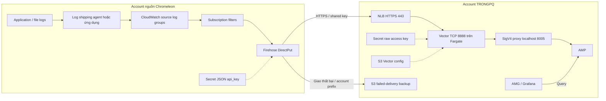

# Chromeleon — Tài nguyên và thông tin cần chuẩn bị trước triển khai

Ngày phân tích: 24/09/2026. Phạm vi: source đang có trong working tree TRONGPQ, chỉ xét Chromeleon và hạ tầng dùng chung phục vụ Chromeleon. Đây là phân tích tĩnh source, không phải kiểm kê tài nguyên đang tồn tại trên AWS; chưa chạy plan/apply hoặc kiểm thử trên AWS.

Đọc tiếp [codex-deploy-resource.md](codex-deploy-resource.md) để xem flow chi tiết, danh mục tài nguyên triển khai, các sửa đổi cần làm và runbook.

## 1. Kết luận về ranh giới tài nguyên

Không thể dựng toàn bộ flow chỉ bằng một lần chạy Terraform hiện tại. Cần chuẩn bị hạ tầng nền, bootstrap KMS/SOPS, triển khai core rồi collectors, sau đó onboarding account nguồn và cấp quyền người dùng Grafana.

| Nhóm | Ai chuẩn bị/quản lý | Có được hai Terraform root hiện tại tạo không? |
|---|---|---|
| AWS accounts, Organization, VPC/subnets/routing, S3 backend state, danh tính triển khai, Identity Center | Cloud/platform team | Không; cần trước khi triển khai |
| Chromeleon application/host, cơ chế đẩy file log vào CloudWatch, source log groups/streams | Chromeleon team | Không; cần trước bước onboarding |
| GitHub Actions OIDC provider, CI roles, environments và runner | Platform/DevOps, nếu dùng CI | Không |
| SOPS KMS key/alias, config bucket, backup bucket, secret bên TRONGPQ, AMP, AMG và IAM tương ứng | Terraform core | Có; không tạo thủ công trùng tên |
| ECS cluster, Chromeleon task/service, NLB, target group, listener, security groups, config object, runtime log groups | Terraform collectors | Có |
| Firehose, hai forwarding roles, secret bên nguồn, delivery log group, subscription filters | CloudFormation onboarding trong account nguồn | Không do Terraform tạo; có template trong repo, triển khai sau collectors |
| DNS domain/zone và chứng chỉ HTTPS hợp lệ | DNS/cloud team hoặc IaC bổ sung | Source hiện tại chỉ import certificate tự ký; chưa có public DNS/ACM validation phù hợp endpoint |
| Gán người/group vào AMG, dashboards, alerts | Platform/observability team hoặc IaC bổ sung | Chưa có resource tương ứng trong source |

**KMS SOPS không phải resource bắt buộc cấp ngoài Terraform.** Nó thuộc core nhưng phải tạo trước khi mã hóa file đầu vào. **Firehose không phải resource cần có trước core**, dù không được Terraform tạo. Hai điểm này quyết định thứ tự triển khai.

GitHub Collector và tài nguyên chuyên dụng cho nó không nằm trong danh mục triển khai. GitHub Actions vẫn được nhắc tới vì là cơ chế CI của Chromeleon. Source vẫn gọi module GitHub và đọc token GitHub; comment “không dùng” không vô hiệu hóa chúng. Cần tách wiring trước khi apply bản chỉ có Chromeleon, xem file triển khai.

## 2. Bản đồ flow cần đáp ứng



Đây là flow **log thành metric**, không phải kho tập trung lưu/tìm kiếm toàn bộ raw logs. AMP nhận metrics; raw logs vẫn phụ thuộc retention của CloudWatch nguồn. S3 backup chỉ phục vụ các lần giao Firehose thất bại theo cấu hình, không thay thế archive toàn bộ logs.

## 3. Tài nguyên nền bắt buộc và thông tin bàn giao

| ID | Tài nguyên/điều kiện | Thông tin cần nhận | Mốc cần sẵn sàng | Cách xác nhận |
|---|---|---|---|---|
| P01 | Account TRONGPQ cho QA và production | Account ID, AWS profile/role ARN, region, SCP/permission boundary áp dụng | Trước init/bootstrap | `aws sts get-caller-identity` đúng account bằng profile tương ứng |
| P02 | Account nguồn Chromeleon | Account ID, region, role triển khai onboarding | Trước onboarding | Xác nhận danh tính riêng; không dùng nhầm profile TRONGPQ |
| P03 | AWS Organization | Org ID và membership account nguồn | Trước backup cross-account | Đối chiếu với `firehose_backup_org_id`; default hiện tại `o-6i2eqlxlo3` chỉ là cấu hình cũ |
| P04 | VPC hiện hữu | `vpc_id`, region, DNS settings, CIDR | Trước collectors | VPC tồn tại trong đúng account/region; source không tạo VPC |
| P05 | Subnets hiện hữu | `subnet_ids`, AZ, số IP trống, route table thực tế | Trước collectors | Các subnet cùng VPC, mỗi subnet NLB thuộc AZ khác nhau; xác nhận cả main route table nếu không có association riêng |
| P06 | Network nền | Internet Gateway, routes, NACL, DNS; NAT/proxy nếu thiết kế dùng private tasks | Trước collectors | Các tuyến trong mục 4 hoạt động; source không tạo các thành phần này |
| P07 | S3 state bucket | Tên bucket, region, owner, encryption, versioning, policy, KMS ARN nếu SSE-KMS | Trước `terraform init` | Role triển khai đọc/ghi state và lock object được |
| P08 | IAM principal bootstrap và triển khai | Engineer role, CI role nếu dùng, quyền dịch vụ và `iam:PassRole` | Trước bootstrap | Có thể tạo các resource thuộc scope, không bị SCP/boundary chặn |
| P09 | IAM Identity Center và danh tính người dùng | Instance/account quản lý, user/group IDs cần cấp quyền AMG | Identity Center trước AMG; assignment sau AMG | Có người quản lý SSO; xác nhận tương thích với account triển khai AMG |
| P10 | Quyền quản lý DNS public | Domain/zone được cấp, FQDN ingestion, bên thêm validation/DNS record | Trước public TLS và onboarding | Chủ sở hữu domain có thể xác thực certificate và trỏ tên về NLB |
| P11 | Chromeleon và nguồn logs | Host/service owner, đường dẫn logs, encoding, format, multiline, log shipper/IAM | Trước E2E | Logs thực sự xuất hiện trong CloudWatch với stream đúng tên |
| P12 | Source CloudWatch log groups/streams | Tên/ARN log groups, streams, retention, subscription đang dùng | Trước CloudFormation onboarding | Tồn tại đúng region, còn quota filter; không chỉ có file trên máy ứng dụng |

Các account có thể trùng nhau, nhưng danh tính và trách nhiệm phải rõ. Cấu hình mặc định hướng tới nguồn và TRONGPQ ở `eu-central-1`; không giả định đổi region chỉ cần sửa một biến vì SigV4 region của Grafana data source hiện hardcode region này.

### 3.1 Backend và cách tách môi trường

CI ghép tên state bucket theo công thức `${TF_STATE_BUCKET_PREFIX}${target_region}`. Hai key cố định:

```text
core/deployment/terraform.tfstate
collectors/deployment/terraform.tfstate
```

`target_environment` không tự thêm prefix môi trường vào key. Vì vậy QA/prod phải dùng bucket khác nhau với workflow hiện tại; nếu dùng chung bucket phải sửa cả backend key và `core_state_key` tương ứng. `core_state_bucket` trong collectors phải bằng bucket thực sự được dùng cho core của đúng môi trường.

Role cần `s3:ListBucket` và đọc/ghi đúng state objects; S3 locking `use_lockfile=true` cần đọc/ghi/xóa object `<key>.tflock`. Không có DynamoDB lock table trong thiết kế hiện tại. Nếu bucket dùng SSE-KMS, phải cấp thêm quyền KMS/key policy thích hợp. [HashiCorp S3 backend](https://developer.hashicorp.com/terraform/language/backend/s3) mô tả các quyền này.

State có thể chứa secret đã giải mã, token Grafana và private key TLS; SOPS chỉ bảo vệ file trong Git. Quyền đọc core remote state thực tế cho phép đọc snapshot state, không chỉ bốn outputs dùng bởi collectors. Không công khai state, file plan hoặc debug logs.

### 3.2 Quyền IAM cần trao đổi với cloud team

| Principal | Nhiệm vụ/quyền cần thiết theo source |
|---|---|
| Người/role chạy core | Quản lý S3 bucket/config/policy, Secrets Manager/version, KMS key/alias/policy, AMP workspace, AMG workspace/service account/token, IAM role/policy; pass AMG role; quyền SOPS decrypt và backend |
| Người/role chạy collectors | Quản lý ECS cluster/task/service, ELBv2, EC2 security groups/rules, CloudWatch Logs, IAM roles/policies/attachments, ACM import hoặc certificate theo thiết kế mới, S3 config object; pass hai ECS roles; đọc core state |
| Engineer author secret | Quyền KMS encrypt/decrypt/generate data key/describe theo key policy, cùng quyền IAM tương ứng; quyền sửa file encrypted |
| CI role | OIDC trust + các quyền deployment trên, backend, SOPS decrypt/describe; quyền tạo/quản lý KMS lúc bootstrap là chuyện riêng với statement chỉ cấp decrypt |
| Người/role onboarding account nguồn | CloudFormation, IAM named roles/policies, Firehose, Secrets Manager, CloudWatch log groups/streams/subscriptions và pass forwarding roles; xem delivery metrics/logs |
| Quản trị SSO/Grafana | Người dùng/groups có sẵn, gán quyền AMG và quyền tạo dashboard/alert theo vai trò |

Đây là phạm vi quyền theo tài nguyên, không phải một policy wildcard hoàn chỉnh để áp dụng nguyên xi. Cloud team cần scope ARN, tags, permission boundary và quyền service-linked-role khi account mới cần tạo role dịch vụ ECS/ELB/Grafana. Runtime roles được Terraform/CloudFormation tạo; không phải tạo trước tất cả các role này bằng tay.

## 4. Network: điều kiện mà source chưa tạo giúp bạn

Source dùng **cùng `subnet_ids` cho internet-facing NLB và ECS task**, mặc định `assign_public_ip=true`.

| Tuyến | Điều kiện |
|---|---|
| Firehose → FQDN ingestion/NLB | DNS public; TLS 443; NLB nằm trong public subnets có tuyến Internet Gateway; NACL phù hợp |
| NLB → Vector | TCP 8888; Terraform tạo rule từ NLB SG tới task SG |
| Vector → SigV4 proxy | HTTP `localhost:8005` trong cùng Fargate task; không cần load balancer/service discovery riêng |
| Task → Docker Hub và Public ECR | Kéo được hai images thực dùng; cho phép DNS và outbound Internet/proxy phù hợp |
| Vector startup → Debian repositories | Chạy `apt-get update/install awscli`; cần outbound theo URL repo của image, có thể gồm HTTP 80 và HTTPS 443 |
| Execution agent → Secrets Manager/CloudWatch Logs | Lấy secret và ghi runtime logs được |
| Task role → S3/AMP | Đọc `chromeleon/vector.yaml`, gửi HTTPS SigV4 tới AMP được |
| Runner → AWS APIs/provider registries/Grafana endpoint | Init providers, gọi AWS và cấu hình data source bằng Grafana provider được |

**Chỉ thêm VPC endpoints chưa đủ để bỏ Internet** với source hiện tại: image ở Docker Hub/Public ECR và còn cài package Debian lúc boot. Muốn private tasks cần tách `nlb_subnet_ids` và `task_subnet_ids` trong source; chuẩn bị NAT hoặc mirror images vào registry phù hợp, build sẵn AWS CLI và thiết kế endpoint tương ứng. Public NLB vẫn cần subnet/routing public. Không đổi toàn bộ `subnet_ids` thành private rồi kỳ vọng flow giữ nguyên.

Hiện ECS chỉ một task nhưng NLB cấu hình nhiều subnets và không bật cross-zone. Cần quyết định coverage theo AZ/cross-zone và kiểm tra health trước onboarding; tăng task count riêng lẻ cũng cần đánh giá cách nhiều Vector writers ghi cùng series AMP. [AWS NLB](https://docs.aws.amazon.com/elasticloadbalancing/latest/network/network-load-balancers.html) nêu cross-zone mặc định tắt và khuyến nghị target ở từng AZ được bật.

## 5. Hợp đồng log đầu vào với Chromeleon team

| File nguồn theo tài liệu repo | CloudWatch stream phải khớp chính xác | Vector sử dụng |
|---|---|---|
| `Service_All.log` | `service-all` | HTTP requests và duration |
| `SdkConsoleApp.log` | `sdk-commands` | SDK command/exit |
| `SdkConsoleApp_Error.log` | `sdk-errors` | Đếm dòng lỗi khớp parser |

`onboarding/log-forwarding-template.yaml` không cài CloudWatch Agent, không tạo source log groups và không cấu hình thu thập các file này. Team ứng dụng phải làm phần file → CloudWatch, cấp quyền ghi logs cho máy/service và xử lý multiline/rotation. Agent có thể là CloudWatch Agent hoặc cơ chế tương đương; repo không xác định cách triển khai cụ thể.

Thu thập sample thực tế cho cả ba streams, gồm request HTTP thành công/thất bại, SDK command/exit, lỗi nhiều dòng. Stream tên khác hoặc format khác phải sửa routing/parser. Dùng log group riêng cho bài E2E trước nếu không muốn chèn dữ liệu kiểm thử vào metrics nghiệp vụ.

Subscription hiện dùng filter rỗng nên chuyển tất cả events của log group. Không subscribe log groups của chính Vector/proxy/Firehose để tránh vòng lặp. Template nhận 1–5 log groups, cần kiểm tra quota subscription còn trống cho từng group bằng account thực tế, không giả định template luôn gắn được filter.

## 6. Secret, KMS và TLS: chuẩn bị gì, tạo ở đâu?

### 6.1 Hai secret cùng một khóa ứng dụng

| Nơi lưu | Định dạng | Chủ sở hữu |
|---|---|---|
| SOPS file `core/deployment/secrets/<environment>.enc.yaml` | Logical key `chromeleon_access_key`, ciphertext trong Git | TRONGPQ |
| TRONGPQ Secrets Manager `trongpq/chromeleon-access-key` mặc định | **Chuỗi key thuần**, vì ECS đưa trực tiếp vào `VECTOR_ACCESS_KEY` | Terraform core |
| Source Secrets Manager `trongpq-ingestion-access-key-<SourceSystemName>` | JSON `{"api_key":"<cùng key>"}` | CloudFormation onboarding |

Key này là shared authentication secret của HTTP endpoint, **không phải AWS IAM AccessKeyId/SecretAccessKey**. Không cần tạo IAM user/access keys dài hạn cho Vector hay Firehose. Hai phía dùng IAM roles cho AWS API; chỉ HTTP Firehose → Vector dùng shared key. Format JSON bên Firehose được quy định trong [AWS HTTP delivery contract](https://docs.aws.amazon.com/firehose/latest/dev/httpdeliveryrequestresponse.html).

Chuẩn bị người chịu trách nhiệm sinh key ngẫu nhiên, trao qua kênh secret an toàn và phối hợp rotation. Có thể dùng key dạng hex để không gặp vấn đề escaping trong `SecretString: !Sub` của template hiện tại. Không lấy key cũ hoặc file encrypted QA hiện tại làm mặc định cho account mới.

### 6.2 Bootstrap SOPS

KMS key được khai báo tại `module.storage.aws_kms_key.sops`, alias `alias/trongpq-sops`. Tạo key bằng targeted bootstrap của core trước, lấy ARN, cập nhật `.sops.yaml`, mã hóa secret rồi mới full apply. Không yêu cầu cloud team tạo thêm key khác với cùng mục đích, trừ khi quyết định sửa thiết kế dùng KMS bên ngoài hoặc import có chủ đích.

KMS alias đang không mang environment. Nếu QA/prod cùng account và region sẽ xung đột; tên secret mặc định và AMG IAM query role cũng xung đột. Cần quyết định account riêng hoặc parameter hóa tên trước bootstrap. Chi tiết lệnh trong file triển khai.

### 6.3 Public TLS — khoảng trống cần giải quyết

Code tạo private key, certificate tự ký CN `<service_name>.internal` rồi import ACM. Output dùng DNS AWS của NLB. Hai tên không khớp và certificate không có public trust chain phù hợp. ACM import thành công không chứng minh Firehose tin certificate đó.

Để dựng endpoint HTTPS có thể kiểm chứng: chuẩn bị quyền domain/zone; cấp certificate public cho FQDN ingestion trong region NLB, gắn listener và tạo DNS record tới NLB. Certificate có thể được DNS/cloud team cấp sẵn để truyền ARN, hoặc tạo bằng IaC bổ sung; **source hiện chưa có input certificate ARN hoặc public DNS resource**. File triển khai chọn phương án certificate cấp sẵn + wiring mới và ghi rõ đây là sửa đổi đề xuất.

Đánh giá đây là điểm chặn nghiệm thu TLS của cấu hình hiện tại; chưa kiểm thử handshake Firehose trên môi trường thật. AWS liệt kê lỗi xác thực certificate path trong [Firehose delivery errors](https://docs.aws.amazon.com/firehose/latest/dev/monitoring-with-cloudwatch-logs.html). Nghiệm thu bằng certificate chain/hostname hợp lệ và E2E, không dùng `curl -k` để kết luận endpoint đúng.

## 7. Nếu dùng CI/CD hiện tại

Chuẩn bị environments `trongpq-qa` và `trongpq-prod` trong repository chạy workflow. Mỗi environment cần:

| Variable | Giá trị cần điền | Source sử dụng |
|---|---|---|
| `AWS_ROLE_ARN` | IAM role OIDC đúng account | `configure-aws-credentials` |
| `PIPELINE_IMAGE` | Runner label thực có runner nhận job | Dùng ở `runs-on`, **không phải Docker image** |
| `TF_STATE_BUCKET_PREFIX` | Prefix ghép region ra đúng bucket đã tạo | `terraform init` |
| `TARGET_STAGE` | Chuỗi stage tổ chức sử dụng | Truyền `target_stage`; hiện chưa ảnh hưởng resource |

OIDC provider và CI role không có resource tạo trong repo. Trust cần audience `sts.amazonaws.com`, subject theo repo/environment thực dùng, ví dụ `repo:<ORG>/<REPO>:environment:trongpq-qa`. Runner cần shell Bash tương thích workflow, Git và runtime cho các Actions đang dùng, đường ra registry/API; pipeline cài Terraform `1.10.5`.

Workflow thật là `.github/workflows/trongpq.yml` gọi `shared-terraform.yml`, không còn hai workflow riêng như README mô tả. Chuỗi job là QA core → QA collectors → prod core → prod collectors; prod có điều kiện main hoặc tag `v*`. Schedule `06:00 UTC` hằng ngày chạy từ default branch; nếu branch đó là main thì điều kiện prod cũng đúng. Workflow tự apply, biến `approval_required` khai báo nhưng không được dùng để tạo approval gate. Cần thiết lập environment protection/trigger phù hợp trước khi bật CI cho account mới.

Push path filter không gồm riêng `onboarding/**`, `docs/**` hoặc `.sops.yaml`; đổi độc lập các đường dẫn này không tự bảo đảm chạy pipeline. Onboarding CloudFormation cũng không được workflow này triển khai. Hai lockfiles hiện có và được CI bắt buộc kiểm tra.

## 8. Những giá trị hiện tại không được sao chép máy móc

| Phát hiện trong working tree | Tác động / điều cần xác nhận |
|---|---|
| QA `ci_role_arn`/engineer ARN trỏ account `285774564005`; tên `core_state_bucket` chứa `740047840182` | Chưa thể kết luận sai account từ tên bucket; xác nhận owner, policy cross-account và bucket thực CI dùng |
| QA/prod collectors đang dùng cùng VPC và ba subnet IDs | Nếu hai account khác nhau thì không thể mặc định dùng cùng IDs; lấy lại theo môi trường |
| Prod `ci_role_arn`, state bucket, KMS ARN trong `.sops.yaml` còn `TODO-*` | Phải thay trước triển khai |
| Chỉ thấy `trongpq-qa.enc.yaml`, chưa có `trongpq-prod.enc.yaml` | Prod chưa đủ đầu vào SOPS |
| Bucket names QA/prod là tên cố định | Cần tên S3 khả dụng, duy nhất; có thể thêm account/region vào convention |
| `sso_instance_arn` được truyền vào module nhưng không dùng trong resource | Điền biến không tự tạo/chọn instance hoặc gán quyền user |
| `grafana_version` mặc định `12.4` | Xác nhận AMG hỗ trợ trong account/region khi triển khai; không coi default là bằng chứng khả dụng |
| Working tree có các file Terraform đã chỉnh và tài liệu chưa tracked | Phân tích dựa trên bản đang có; khi rebuild cần lưu đúng snapshot đã review |

## 9. Phiếu đầu vào bàn giao cho mỗi môi trường

Điền bảng này trước khi chạy runbook; đây là thông tin đầu vào, không phải giá trị đã xác minh:

| Trường | Giá trị cần điền |
|---|---|
| Environment / stage | `trongpq-qa` hoặc `trongpq-prod` / `<stage>` |
| TRONGPQ account / deployment profile / region | `<account>` / `<profile>` / `eu-central-1` |
| Source account / profile / region / Organization | `<account>` / `<profile>` / `<region>` / `<org-id>` |
| State bucket / region / core key / collectors key | `<bucket>` / `<region>` / hai key đã thống nhất |
| VPC / NLB subnets / task subnets / outbound design | `<vpc>` / `<subnets>` / `<subnets>` / public hoặc private sau sửa source |
| CI role / SOPS engineer principal ARNs | `<role>` / `<roles>` |
| S3 config / backup bucket names | `<unique-config-bucket>` / `<unique-backup-bucket>` |
| AMP alias / AMG workspace / ECS cluster / service | `<names-per-environment>` |
| Tên secret / alias KMS / AMG role | `<names-isolated-per-environment>` |
| Public ingestion FQDN / DNS owner / certificate ARN | `<fqdn>` / `<owner>` / `<ARN sau cấp>` |
| SourceSystemName / log groups / log stream mapping | `<unique-system-name>` / `<groups>` / ba streams ở mục 5 |
| SSO user/group / Grafana role | `<IDs>` / ADMIN, EDITOR hoặc VIEWER |
| Access key owner / cách chuyển key | `<owner>` / `<secret channel, không ghi key vào tài liệu>` |
| KMS ARN / encrypted secret file | `<output sau bootstrap>` / `secrets/<env>.enc.yaml` |

## 10. Điều kiện chuyển sang triển khai

- [ ] Có tài khoản, role, backend, VPC/subnets/routing đã xác nhận cho từng môi trường.
- [ ] Chọn được cách tách QA/prod state và tên resource; không còn placeholder.
- [ ] Có Identity Center và người phụ trách assignment sau khi tạo AMG.
- [ ] Có domain/DNS owner và kế hoạch thay certificate tự ký.
- [ ] Có source log groups với log thật, stream names và samples đúng hợp đồng.
- [ ] Xác nhận Organization/prefix/policy phục vụ backup cross-account.
- [ ] Chọn triển khai local hoặc CI; bootstrap KMS/SOPS trước full core.
- [ ] Đã đọc các điểm cần sửa trong [file triển khai](codex-deploy-resource.md); chưa coi nguyên trạng source là bản Chromeleon-only hoàn chỉnh.

## 11. Nguồn đối chiếu trong repository

- [Core root](../core/deployment/main.tf), [core inputs](../core/deployment/variables.tf), [storage](../core/deployment/modules/storage/main.tf), [observability](../core/deployment/modules/observability/main.tf).
- [Collectors root](../collectors/deployment/main.tf), [collectors inputs](../collectors/deployment/variables.tf), [Chromeleon module](../collectors/deployment/modules/chromeleon-collector/main.tf), [Vector config](../collectors/config/chromeleon/vector.yaml).
- [Onboarding template](../onboarding/log-forwarding-template.yaml), [hợp đồng forwarding](log-forwarding-instructions.md).
- [Workflow thực tế](../.github/workflows/trongpq.yml), [reusable workflow](../.github/workflows/shared-terraform.yml), [SOPS bootstrap](../core/deployment/secrets/README.md), [SOPS rules](../.sops.yaml).

Khi tài liệu cũ và resource blocks khác nhau, các kết luận về “hiện tại” ở hai file này ưu tiên source thực tế. Các điều kiện AWS chỉ được xác nhận khi kiểm tra môi trường triển khai.
